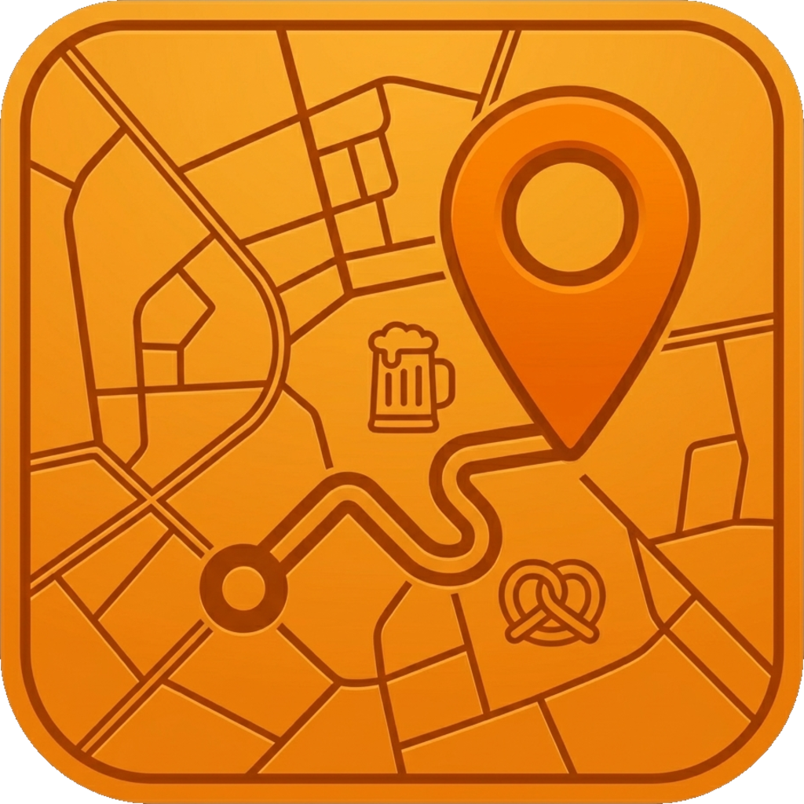
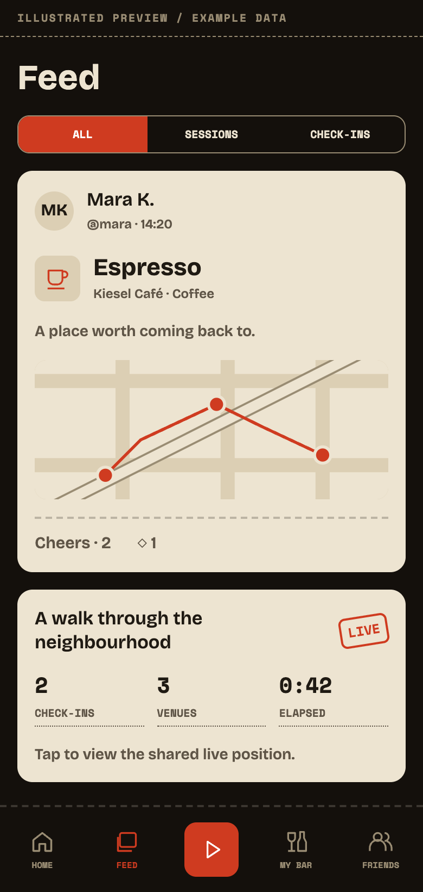
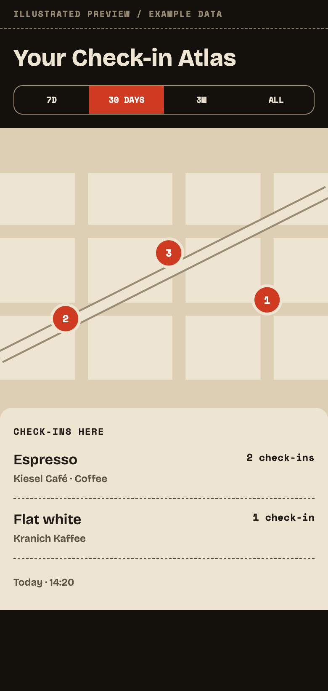
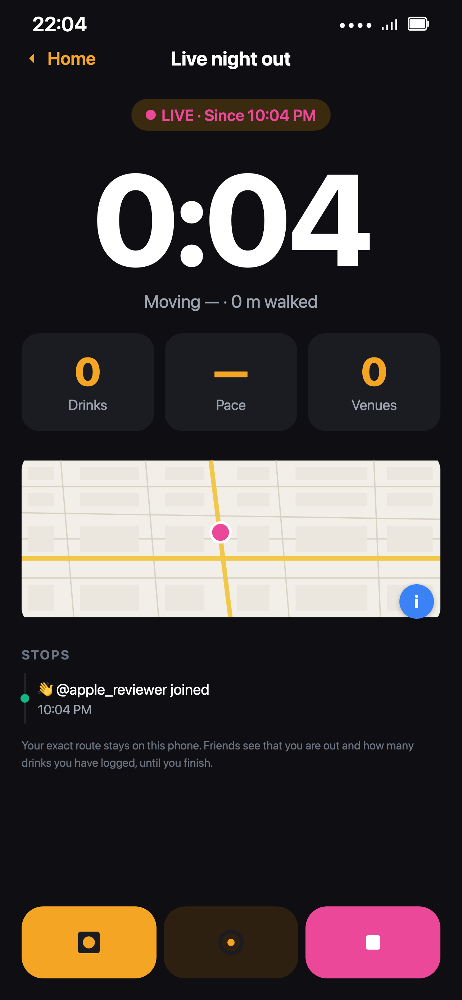

  

<h1 align="center">CheersOida</h1>

  <strong>Discover places. Track your route.</strong>

  
  

> 🐛 **Found a bug?** Open an issue on this repo — it also tracks CheersOida app bugs and feature requests, and every report gets read.

**Get the app:** CheersOida is in closed preview — email **[cheers@cheersoida.app](mailto:cheers@cheersoida.app)** to be added to TestFlight or Google Play internal testing.

## What is CheersOida?

CheersOida helps you keep track of the places you visit and discover somewhere new. Press **Start** before you head out to record your walking route and detect venue stops. Your route, visited places, and check-ins come together on a map, with a summary of distance and duration afterwards.

## Features

- **GPS route** — keep a map of the paths you walk and the places you visit.
- **Dwell detection** — arriving at a venue is the signal; walking past is not.
- **Friends & Cheers** — your mates see your check-ins in real time and send a one-tap Cheers.
- **Bilingual DE / EN** — owned and operated from Austria.

## Screenshots

  
  &nbsp;&nbsp;
  
  &nbsp;&nbsp;
  

## Support

- **Account, previews, anything user-facing:** [cheers@cheersoida.app](mailto:cheers@cheersoida.app)
- **Full developer documentation:** [github.com/checkelmann/CheersOida](https://github.com/checkelmann/CheersOida)

---

## Deutsch

  <strong>Orte entdecken. Routen festhalten.</strong>

  

> 🐛 **Bug gefunden?** Eröffne ein Issue in diesem Repo — CheersOida-App-Bugs und Feature-Wünsche werden ebenfalls hier getrackt, jedes Report wird gelesen.

**App holen:** CheersOida ist im Closed Preview — schreib eine E-Mail an **[cheers@cheersoida.app](mailto:cheers@cheersoida.app)**, um zu TestFlight oder Google Play Internal Testing eingeladen zu werden.

## Was ist CheersOida?

CheersOida hilft dir, besuchte Orte im Blick zu behalten und neue zu entdecken. Drück vor dem Losgehen auf **Start**, um deinen Fußweg aufzuzeichnen und Stopps an Locations zu erkennen. Deine Route, besuchte Orte und Check-ins kommen auf einer Karte zusammen. Danach siehst du eine Zusammenfassung mit Distanz und Dauer.

## Funktionen

- **GPS-Route** — behalte deine Wege und besuchten Orte auf einer Karte.
- **Dwell-Erkennung** — das Ankommen an einer Location ist das Signal; das Vorbeigehen zählt nicht.
- **Friends & Cheers** — deine Freunde sehen deine Check-ins in Echtzeit und schicken einen Cheers mit einem Tap.
- **Bilingual DE / EN** — aus Österreich, für Österreich und den DACH-Raum.

## Support

- **Account, Previews, alles User-seitige:** [cheers@cheersoida.app](mailto:cheers@cheersoida.app)
- **Vollständige Entwicklerdokumentation:** [github.com/checkelmann/CheersOida](https://github.com/checkelmann/CheersOida)

---

[Privacy policy](https://checkelmann.github.io/cheersoida-website/privacy.html) · [CheersOida app repo](https://github.com/checkelmann/CheersOida) · [cheersoida-website repo](https://github.com/checkelmann/cheersoida-website) · © 2026
