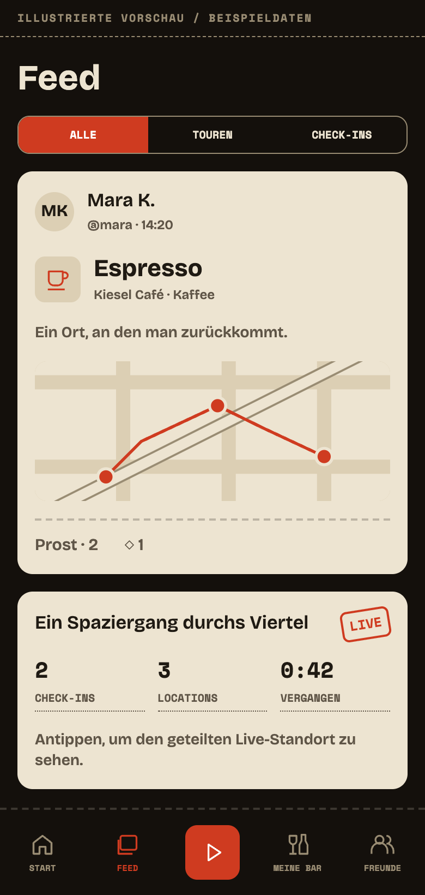
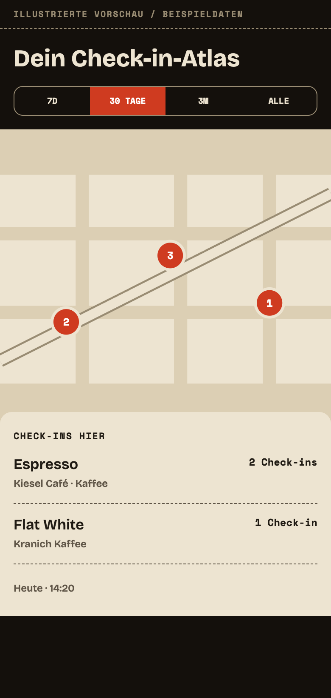
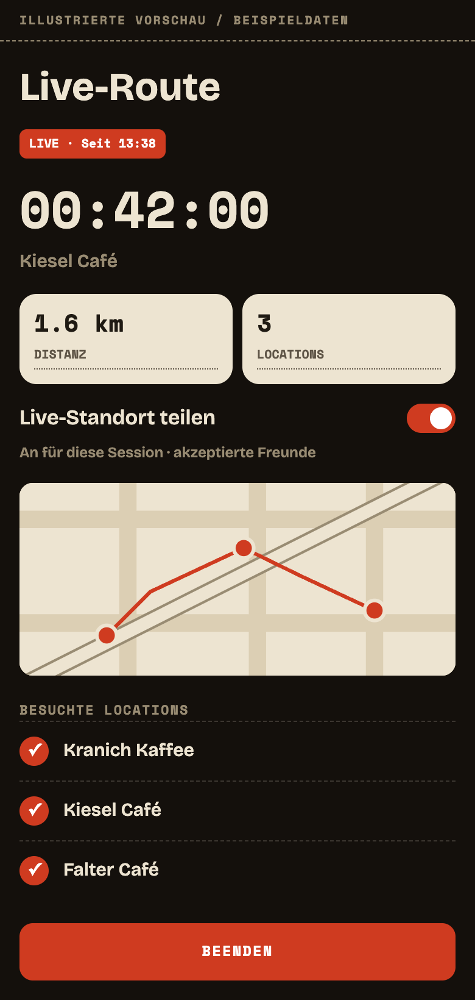

  

<h1 align="center">CheersOida</h1>

  <strong>Discover places. Track your route.</strong>

  
  

> 🐛 **Found a bug?** Open an issue on this repo — it also tracks CheersOida app bugs and feature requests, and every report gets read.

**Get the app:** CheersOida is in closed preview — email **[cheers@cheersoida.app](mailto:cheers@cheersoida.app)** to be added to TestFlight or Google Play internal testing.

## What is CheersOida?

CheersOida helps you keep track of the places you visit and discover somewhere new. Press **Start** before you head out to record your walking route and detect venue stops. Your route, visited places, and check-ins come together on a map, with a summary of distance and duration afterwards.

## Features

- **GPS route** — keep a map of the paths you walk and the places you visit.
- **Venue stops** — detect time spent near known venues and add a missing place when needed.
- **Check-in Atlas** — explore your located check-ins by time and place.
- **Friends & live sharing** — accepted friends can see your latest position during a new session by default; turn sharing off for that session in the live screen.
- **Cheers & messages** — respond to friends’ check-ins from the feed.
- **Offline queue** — save activity locally and retry pending uploads when connected.
- **Data controls** — clear activity history while keeping your account, or request account deletion.
- **Bilingual DE / EN** — owned and operated from Austria.

## Interface previews

Illustrations of the current visual style with example content; these are not device screenshots.

  
  &nbsp;&nbsp;
  
  &nbsp;&nbsp;
  

## Support

- **Account, previews, anything user-facing:** [cheers@cheersoida.app](mailto:cheers@cheersoida.app)
- **Full developer documentation:** [github.com/checkelmann/CheersOida](https://github.com/checkelmann/CheersOida)

---

## Deutsch

  <strong>Orte entdecken. Routen festhalten.</strong>

  

> 🐛 **Bug gefunden?** Eröffne ein Issue in diesem Repo — CheersOida-App-Bugs und Feature-Wünsche werden ebenfalls hier getrackt, jedes Report wird gelesen.

**App holen:** CheersOida ist im Closed Preview — schreib eine E-Mail an **[cheers@cheersoida.app](mailto:cheers@cheersoida.app)**, um zu TestFlight oder Google Play Internal Testing eingeladen zu werden.

## Was ist CheersOida?

CheersOida hilft dir, besuchte Orte im Blick zu behalten und neue zu entdecken. Drück vor dem Losgehen auf **Start**, um deinen Fußweg aufzuzeichnen und Stopps an Locations zu erkennen. Deine Route, besuchte Orte und Check-ins kommen auf einer Karte zusammen. Danach siehst du eine Zusammenfassung mit Distanz und Dauer.

## Funktionen

- **GPS-Route** — behalte deine Wege und besuchten Orte auf einer Karte.
- **Besuchte Orte** — Verweilen nahe bekannter Locations erkennen und fehlende Orte ergänzen.
- **Check-in-Atlas** — eigene Check-ins mit Standort nach Zeitraum und Ort erkunden.
- **Freunde & Live-Freigabe** — neue Sessions teilen den letzten Standort zunächst mit akzeptierten Freunden; im Live-Bildschirm kannst du das für die Session ausschalten.
- **Prost & Nachrichten** — im Feed auf die Check-ins deiner Freunde reagieren.
- **Offline-Warteschlange** — Aktivitäten lokal speichern und ausstehende Übertragungen bei Verbindung erneut versuchen.
- **Datenkontrolle** — Aktivitätsverlauf bei bestehendem Konto oder das ganze Konto löschen.
- **Bilingual DE / EN** — aus Österreich, für Österreich und den DACH-Raum.

## Vorschauen der Oberfläche

Illustrationen des aktuellen Designs mit Beispieldaten, keine Geräte-Screenshots.

  
  &nbsp;&nbsp;
  
  &nbsp;&nbsp;
  

## Support

- **Account, Previews, alles User-seitige:** [cheers@cheersoida.app](mailto:cheers@cheersoida.app)
- **Vollständige Entwicklerdokumentation:** [github.com/checkelmann/CheersOida](https://github.com/checkelmann/CheersOida)

---

[Privacy policy](https://cheersoida.app/privacy.html) · [CheersOida app repo](https://github.com/checkelmann/CheersOida) · [cheersoida-website repo](https://github.com/checkelmann/cheersoida-website) · © 2026
